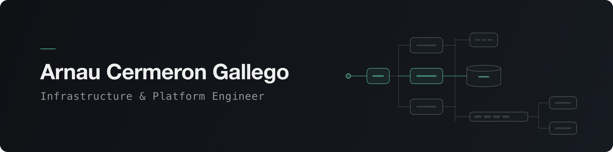

I'm a platform engineer who thinks like an architect. I care about why a system is built a certain way, what it costs and who it affects, not just about getting it running.

At [Tranxfer](https://www.tranxfer.com/) I'm responsible for the infrastructure behind a secure file-exchange platform used by banks, insurers and other regulated companies, across AWS, GCP and Azure. Based in Barcelona.

### What I work on

- **Multi-cloud platform.** Kubernetes on AWS, GCP and Azure, defined in Terraform and deployed with GitOps through Argo CD.
- **On-demand environments.** Every feature gets its own isolated environment, created and removed from its pipeline. I designed and built it as my Bachelor's thesis and it's now part of the team's daily workflow.
- **Reliability.** Monitoring and alerting in Datadog that points to real problems, and root-cause analysis from the infrastructure down to the application code.
- **Security.** Finding and fixing weaknesses across a platform that regulated clients depend on.

### How I work

- I put the trade-offs on the table. Before building, I compare the options, pick one and write down why.
- I explain decisions so people can act on them, from a design doc for engineers to a proposal with costs and risks for the business.
- I treat cost and performance as design goals, not something to fix later.

### Stack

- **Cloud:** AWS · Google Cloud · Azure
- **Platform:** Kubernetes · Helm · Argo CD · Terraform · Docker
- **Delivery and observability:** Bitbucket Pipelines · Datadog
- **Code:** Python · Bash · Java / Spring Boot · TypeScript · Angular
- **Data:** PostgreSQL · Redis

### Background

I started as a full-stack developer, so I reason about the whole system and not just the infrastructure layer. I'm finishing International Computer Engineering at La Salle Barcelona (February 2027), including a semester at NTNU in Norway and short programmes in the US and Japan.

Most of my day-to-day work lives in private repositories.

[LinkedIn](https://www.linkedin.com/in/arnau-cermeron-gallego/) · [Email](mailto:arnaucermeron@gmail.com)
